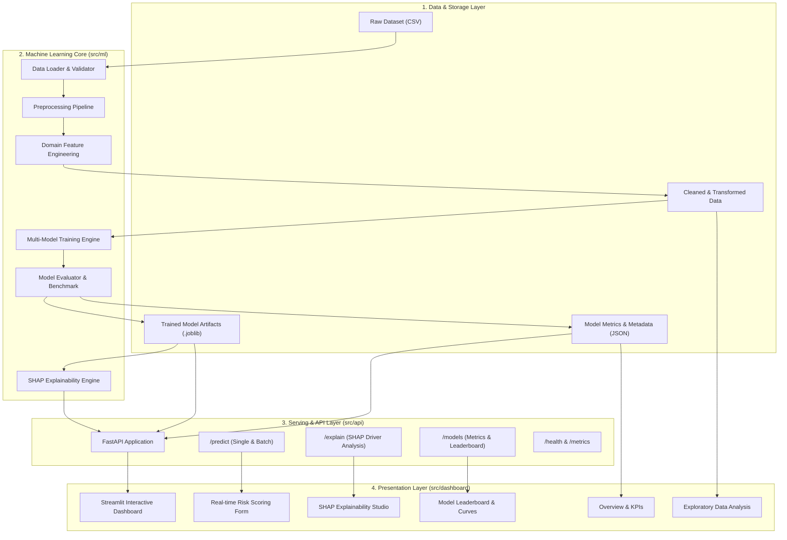
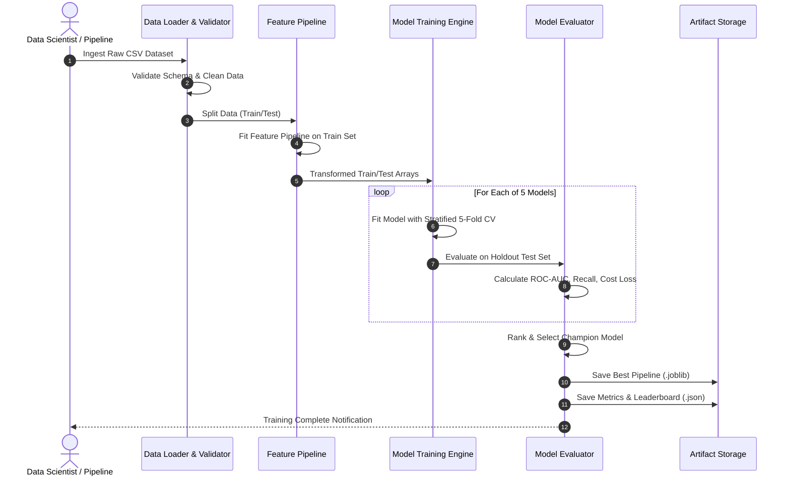
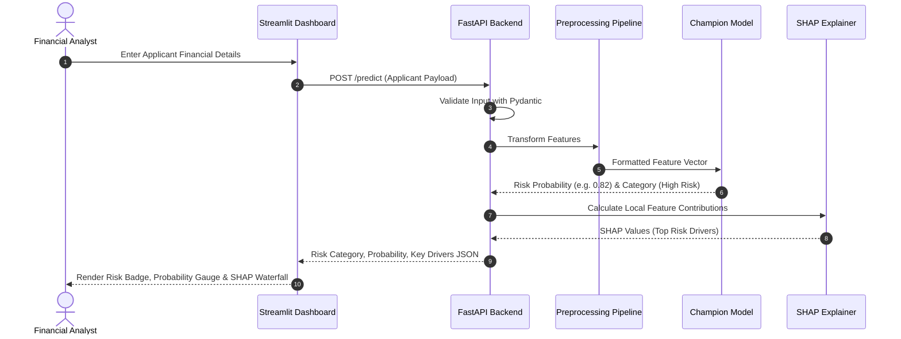

# System Architecture & Technical Design Document

- **System Name:** Financial Risk Prediction Platform (FRP-ML)
- **Document Version:** 1.0.0
- **Status:** Approved / Engineering Blueprint
- **Author:** Lead ML Architect & System Design Team

---

## 1. Architectural Overview

The Financial Risk Prediction Platform is designed following a **modular, decoupled, layered architecture** that cleanly separates data ingestion, machine learning pipelines, model artifacts, inference services, and analytical presentation.

### High-Level Architecture Diagram

---

## 2. Layered Component Architecture

### Layer 1: Data Ingestion & Validation Layer (`src/data/`)
- **Responsibilities:**
  - Ingest raw CSV data from disk, user uploads, or benchmark repositories.
  - Execute strict schema validation: column names, required fields, data types, permissible ranges (e.g. `person_age` between 18 and 100, `person_income` $\ge 0$).
  - Clean missing values, drop duplicates, and flag anomalous outliers.
  - Partition data into stratified train and test splits (80% train / 20% test).
- **Core Modules:**
  - `data_loader.py`: Handles file I/O and format parsing.
  - `validator.py`: Pydantic / Schema validation rules.
  - `cleaner.py`: Missing value and outlier handling.

### Layer 2: Preprocessing & Feature Engineering Layer (`src/features/`)
- **Responsibilities:**
  - Implement scikit-learn compatible `TransformerMixin` pipelines.
  - Compute domain financial ratios:
    - *Loan-to-Income (LTI):* `loan_amnt / person_income`
    - *Interest Burden Index:* `(loan_amnt * (loan_int_rate / 100)) / person_income`
    - *Credit History-to-Age Ratio:* `cb_person_cred_hist_length / person_age`
  - Perform median/mode imputation fitted strictly on training data.
  - Apply One-Hot Encoding for nominal variables (`person_home_ownership`, `loan_intent`) and Ordinal Encoding for ranked variables (`loan_grade`).
  - Feature scaling using `StandardScaler` / `RobustScaler`.
- **Core Modules:**
  - `feature_pipeline.py`: Assembles `ColumnTransformer` and custom ratio transformers.
  - `transformers.py`: Custom feature transformation classes.

### Layer 3: Machine Learning & Training Layer (`src/models/`)
- **Responsibilities:**
  - Implement training routines for 5 diverse classification models:
    1. **Logistic Regression:** ElasticNet/L2 regularization baseline.
    2. **Decision Tree:** Interpretable tree with depth and min-split controls.
    3. **Random Forest:** Ensemble bagging with out-of-bag scoring and parallel execution.
    4. **XGBoost:** Gradient boosted trees with logloss objective and scale_pos_weight.
    5. **Support Vector Machine (SVM):** Non-linear RBF kernel with Platt probability calibration.
  - Perform 5-fold Stratified Cross-Validation (`StratifiedKFold`).
  - Address class imbalance through `class_weight='balanced'` and optional SMOTE.
  - Hyperparameter optimization using `GridSearchCV` / `RandomizedSearchCV`.
- **Core Modules:**
  - `train.py`: Orchestrates multi-model training and cross-validation.
  - `model_registry.py`: Model loader, serializer (`joblib`), and version manager.

### Layer 4: Model Evaluation & Benchmarking Layer (`src/evaluation/`)
- **Responsibilities:**
  - Compute standard classification metrics: Accuracy, Precision, Recall, F1-Score, ROC-AUC, PR-AUC.
  - Generate Confusion Matrices and Decision Curve summaries.
  - Calculate Cost-Sensitive Expected Loss:
    $$\text{Cost} = (C_{FN} \times FN) + (C_{FP} \times FP)$$
    where $C_{FN} = 5$ (Loss incurred by defaulting loan) and $C_{FP} = 1$ (Opportunity cost of rejected good borrower).
  - Select and flag the "Champion Model" based on optimal Recall/ROC-AUC balance.
  - Export evaluation results to `models/metadata/model_comparison.json`.
- **Core Modules:**
  - `evaluator.py`: Metric calculation and comparison table generator.
  - `cost_matrix.py`: Cost-sensitive threshold evaluation.

### Layer 5: Explainable AI (XAI) Layer (`src/explainability/`)
- **Responsibilities:**
  - Compute SHAP values for global and local interpretability.
  - Leverage `shap.TreeExplainer` for tree models (XGBoost, Random Forest) and `shap.Explainer` / `KernelExplainer` for linear/SVM models.
  - Global Interpretability: Mean absolute SHAP values ranking the most influential risk factors across the portfolio.
  - Local Interpretability: Waterfall decomposition showing how each borrower feature pushes the risk prediction above or below the baseline expected value.
  - Natural Language Synthesis: Translate top SHAP vectors into human-readable bullet points (e.g., *"High loan-to-income ratio (+18% risk), low credit history length (+9% risk)"*).
- **Core Modules:**
  - `shap_explainer.py`: Computes SHAP values and feature contributions.
  - `report_generator.py`: Generates narrative risk driver summaries.

### Layer 6: API Service Layer (`src/api/`)
- **Responsibilities:**
  - Expose high-performance asynchronous REST endpoints using **FastAPI**.
  - Provide auto-generated OpenAPI / Swagger UI docs (`/docs`).
  - Input payload validation using Pydantic schemas.
  - Endpoints:
    - `GET /health`: System health and loaded model status.
    - `POST /predict`: Real-time single applicant risk scoring.
    - `POST /predict/batch`: Bulk CSV risk prediction.
    - `POST /explain`: SHAP value breakdown for a submitted applicant.
    - `GET /models`: Performance leaderboard and metadata.
- **Core Modules:**
  - `main.py`: FastAPI server setup, CORS middleware, routes.
  - `schemas.py`: Request and response Pydantic models.
  - `routes/`: Modular route handlers for prediction, explainability, and metrics.

### Layer 7: Interactive Presentation Layer (`src/dashboard/`)
- **Responsibilities:**
  - Multi-page analytical dashboard powered by **Streamlit**.
  - Dynamic visualizations using Plotly and Seaborn.
  - Interactive risk calculator with sliders, dropdowns, and gauge charts.
  - CSV file uploader for batch scoring with instant download of enriched files.
- **Core Modules:**
  - `app.py`: Main dashboard entry point and navigation sidebar.
  - `pages/`:
    - `1_Overview.py`: Executive KPIs and portfolio risk overview.
    - `2_EDA.py`: Interactive exploratory analysis, correlations, distributions.
    - `3_Model_Comparison.py`: Metrics leaderboard, ROC curves, confusion matrices.
    - `4_Risk_Prediction.py`: Applicant scoring form and batch processor.
    - `5_Explainability.py`: Global feature importance and individual SHAP waterfall plots.

---

## 3. Data Flow & Sequence Workflows

### 3.1 Model Training & Evaluation Workflow

### 3.2 Real-Time Prediction & Explainability Workflow

---

## 4. Technology Stack Justification

| Component | Technology | Rationale & Selection Criteria |
| :--- | :--- | :--- |
| **Language** | Python 3.10 - 3.12 | Industry standard for ML, XAI, and analytical backends. |
| **Data Manipulation** | Pandas 2.x, NumPy 1.26+ | Fast tabular operations, vectorized calculations, scikit-learn interoperability. |
| **Data Visualization** | Plotly, Matplotlib, Seaborn | Interactive browser plots (Plotly) + publication-quality static charts (Seaborn). |
| **Machine Learning** | Scikit-Learn, XGBoost | Scikit-learn provides standard pipeline APIs, cross-validation, and metrics; XGBoost delivers state-of-the-art gradient boosted tree performance. |
| **Model Explainability**| SHAP (Shapley Additive exPlanations) | Game-theoretic, mathematically rigorous local and global interpretability. Essential for financial regulatory compliance. |
| **Backend API** | FastAPI, Uvicorn, Pydantic v2 | High-speed asynchronous ASGI framework, automated Swagger/OpenAPI docs, strict type safety. |
| **Frontend UI** | Streamlit | Rapid, Python-native reactive dashboard framework ideal for financial analytics and ML inspection. |
| **Model Serialization**| Joblib | Optimized persistence for scikit-learn estimators and NumPy array pipelines. |
| **Testing** | Pytest | Industry-standard test runner for unit, integration, and API validation. |

---

## 5. Security, Reliability & Compliance Design

1. **Deterministic Reproducibility:**
   - All random number generators (`numpy.random`, `random`, `sklearn`, `xgboost`) are seeded with `SEED = 42`.
2. **Data Leakage Prevention:**
   - Imputation parameters, scaler means/variances, and encoder maps are fitted exclusively on the training subset and applied downstream to the test/inference sets.
3. **Graceful Fallbacks & Validation:**
   - Zero-division guards in financial ratio calculations (`loan_percent_income`).
   - Range validation bounds rejecting impossible inputs (e.g., negative employment lengths).
4. **Regulatory Transparency:**
   - Predictions are never opaque "black boxes"; every high-risk classification is accompanied by signed SHAP attribution vectors detailing exact feature contributions.
