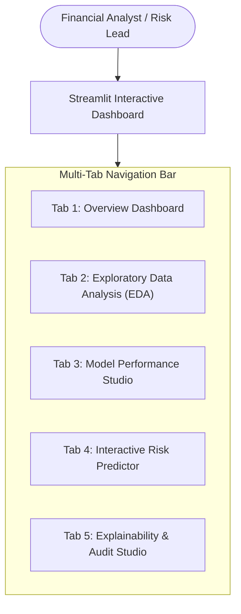

# Frontend Dashboard Specification (Streamlit)

## Project: Financial Risk Prediction Platform (`Project 3`)
**Version:** 1.0  
**Module Target:** `dashboard/` (`app.py`, `components/`, `views/`, `styles.css`)  
**Framework:** Streamlit 1.32+  
**Execution Command:** `streamlit run dashboard/app.py`  

---

## 1. User Experience & Design Philosophy

The Financial Risk Prediction Dashboard is designed for **Financial Analysts, Credit Underwriters, and Risk Managers**. It provides a frictionless interface that balances high-level executive summaries with micro-level applicant inspections and deep explainability audits.



### Design Standards:
* **Palette:** Financial Corporate Dark/Light Theme: Navy Blue (`#0B2545`), Slate (`#134074`), Forest Green (`#28A745`), Crimson Danger (`#DC3545`), Gold Warning (`#FFC107`).
* **Interactivity:** Instant reactive re-rendering with cached backend data (`st.cache_data`, `st.cache_resource`).
* **Feedback:** Inline error handling, tooltips explaining financial jargon, and downloadable audit reports (CSV/PDF).

---

## 2. Multi-Tab Page Architecture & UI Components

### Tab 1: Executive Overview Dashboard
* **Purpose:** Portfolio-level health monitoring and executive summary.
* **Layout & Components:**
  1. **Top Metric Cards (KPI Ribbon):**
     * `Total Records Evaluated`: e.g. `45,000`
     * `Portfolio High-Risk Rate`: e.g. `21.8%` (Delta: `-1.2%` vs last quarter)
     * `Champion Model`: e.g. `XGBoost Classifier`
     * `Model ROC-AUC Score`: e.g. `0.912`
     * `Estimated Default Savings`: e.g. `+$1,840,000`
  2. **Risk Category Distribution Donut Chart (Plotly):**
     * Segments: Low Risk (78.2%), High Risk (21.8%).
     * Hover reveals count and percentage.
  3. **Champion Model Performance Summary Card:**
     * Mini-table with Precision, Recall, F1, Accuracy, and optimal threshold indicator ($\tau = 0.40$).
  4. **Recent High-Risk Inflow Stream:**
     * Data table displaying the last 10 scored applicants with status badges.

---

### Tab 2: Exploratory Data Analysis (EDA)
* **Purpose:** Understand the underlying financial dataset distributions, correlations, and anomalies.
* **Layout & Components:**
  1. **Dataset Summary Table:**
     * Display row count, column data types, missing value percentages, and memory usage.
  2. **Interactive Distribution Visualizer:**
     * Dropdown selector: `person_income`, `loan_amnt`, `loan_int_rate`, `debt_to_income`, `delinq_2yrs`.
     * Interactive Histogram + KDE curve with toggle to split by `loan_status` (High Risk vs. Low Risk).
  3. **Correlation Heatmap (Plotly):**
     * Interactive heatmap of Pearson/Spearman correlation coefficients.
     * Filter slider: Only display feature pairs with $|r| \ge \text{threshold}$.
  4. **Categorical Risk Breakdown Charts:**
     * Bar charts of Default Rate by `loan_intent` (e.g. Debt Consolidation vs Medical) and `person_home_ownership` (Rent vs Mortgage vs Own).
  5. **Outlier Boxplot Studio:**
     * Log-scaled boxplots identifying extreme debt or income values.

---

### Tab 3: Model Performance Studio
* **Purpose:** Compare all 5 trained classification algorithms and evaluate business trade-offs.
* **Layout & Components:**
  1. **Model Leaderboard Comparison Table:**
     * Multi-column table comparing: Algorithm Name, Accuracy, Precision, Recall, F1-Score, ROC-AUC, PR-AUC, and Total Financial Cost ($).
     * Color highlighting best-in-class values.
  2. **Comparative ROC Curves & Precision-Recall Curves:**
     * Overlay of all 5 models on a single interactive plot with AUC legends.
  3. **Interactive Confusion Matrix Studio:**
     * Model selector dropdown.
     * Dynamic classification threshold slider ($\tau \in [0.10, 0.90]$, default `0.40`).
     * Real-time update of True Positives, False Positives, True Negatives, False Negatives, and calculated financial loss.

---

### Tab 4: Interactive Risk Predictor
* **Purpose:** Real-time credit risk scoring for individual applicant assessment.
* **Layout & Components:**
  1. **Grouped Input Form (2-Column Grid):**
     * **Column A (Demographics & Income):**
       * Applicant ID (`text_input`, default: `APP-2026-001`)
       * Age (`number_input`: 18–100, default: 28)
       * Annual Gross Income (`number_input`: \$1,000–\$5,000,000, default: \$65,000)
       * Home Ownership (`selectbox`: `RENT`, `MORTGAGE`, `OWN`, `OTHER`)
       * Employment Tenure in Years (`slider`: 0.0–30.0, default: 4.5)
     * **Column B (Loan & Credit Liabilities):**
       * Loan Intent (`selectbox`: `DEBTCONSOLIDATION`, `EDUCATION`, `MEDICAL`, `PERSONAL`, `HOMEIMPROVEMENT`, `VENTURE`)
       * Loan Grade (`selectbox`: `A`, `B`, `C`, `D`, `E`, `F`, `G`, default: `C`)
       * Requested Loan Amount (`number_input`: \$500–\$50,000, default: \$15,000)
       * Loan Interest Rate % (`slider`: 4.0%–30.0%, default: 11.5%)
       * Past Default on File (`radio`: `No`, `Yes`)
       * Credit History Length (`number_input`: 1–40 years, default: 6)
       * Revolving Utilization (`slider`: 0.0–1.5, default: 0.42)
       * Delinquencies in Past 2 Years (`number_input`: 0–15, default: 0)
       * Total Outstanding Debt (`number_input`: \$0–\$500,000, default: \$22,000)
  2. **Execution Trigger:** Prominent "Assess Financial Risk" button (`type='primary'`).
  3. **Output Presentation Container:**
     * **Risk Gauge Chart (Plotly Indicator Gauge):**
       * Displays predicted probability needle (0% to 100%).
       * Color bands: Green (0–25%), Yellow (25–45%), Orange (45–70%), Red (70–100%).
     * **Decision Status Badge:**
       * `LOW RISK (Auto-Approve)` or `HIGH RISK (Review / Denial)`.
     * **Derived Financial Summary Card:**
       * Displays calculated DTI (`33.8%`), LTI (`23.1%`), and Monthly Disposable Income (`$4,775`).
     * **Key Risk Factors Callout:**
       * Bullet points with top 3 risk factors and positive credit factors.

---

### Tab 5: Explainability & Audit Studio
* **Purpose:** Audit WHY a decision was made for regulatory compliance and scenario simulation.
* **Layout & Components:**
  1. **Global Feature Importance Chart:**
     * Bar chart showing top 15 most important features by Mean |SHAP| value across the portfolio.
  2. **Individual SHAP Waterfall Plot:**
     * Dynamic waterfall chart showing the exact push-and-pull contributions of each feature for the applicant evaluated in Tab 4.
  3. **Interactive "What-If" Counterfactual Simulator:**
     * Allows underwriters to test hypothetical scenarios to advise applicants on how to improve creditworthiness:
       * *Slider:* "Reduce total debt by \$X" $\rightarrow$ recalculates risk score in real-time.
       * *Slider:* "Increase down-payment / reduce loan amount by \$Y".
       * *Toggle:* "Remove delinquent account through dispute".
       * Displays before-and-after risk score comparison.

---

## 3. Code Architecture & Modular Implementation

The dashboard is structured into reusable modules:

```text
dashboard/
├── app.py                  # Main entrypoint, sidebar, and tab navigation
├── styles.css              # Custom CSS styling
├── components/
│   ├── kpi_cards.py        # Executive KPI ribbon cards
│   ├── charts.py           # Plotly gauge, ROC, distributions, heatmaps
│   └── waterfall.py        # Custom SHAP waterfall renderer
└── views/
    ├── tab1_overview.py    # Executive overview page
    ├── tab2_eda.py         # Exploratory data analysis page
    ├── tab3_performance.py # Model benchmarking page
    ├── tab4_predict.py     # Interactive risk assessment form
    └── tab5_explain.py     # SHAP audit and What-If simulator
```

### Main Application Skeleton (`dashboard/app.py`)

```python
import streamlit as st
import pandas as pd
import joblib

st.set_page_config(
    page_title="Financial Risk Prediction Platform",
    page_icon=":material/monitoring:",
    layout="wide",
    initial_sidebar_state="expanded"
)

# Custom header
st.title("Financial Risk Prediction & Analytics Platform")
st.caption("Production Machine Learning System for Credit Risk Underwriting & Explainable AI")

# Tabs
tab1, tab2, tab3, tab4, tab5 = st.tabs([
    "Overview",
    "Data Analysis (EDA)",
    "Model Performance",
    "Risk Prediction",
    "Explainability & Audit"
])

with tab1:
    st.header("Executive Portfolio Overview")
    # Render KPI cards and summary

with tab2:
    st.header("Exploratory Data Analysis")
    # Render distributions, heatmaps, outliers

with tab3:
    st.header("Machine Learning Model Benchmarking")
    # Render 5-model table, ROC curves, confusion matrix

with tab4:
    st.header("Interactive Applicant Risk Scoring")
    # Render applicant input form and real-time risk gauge

with tab5:
    st.header("Model Explainability (SHAP) & What-If Studio")
    # Render waterfall and counterfactual simulator
```
