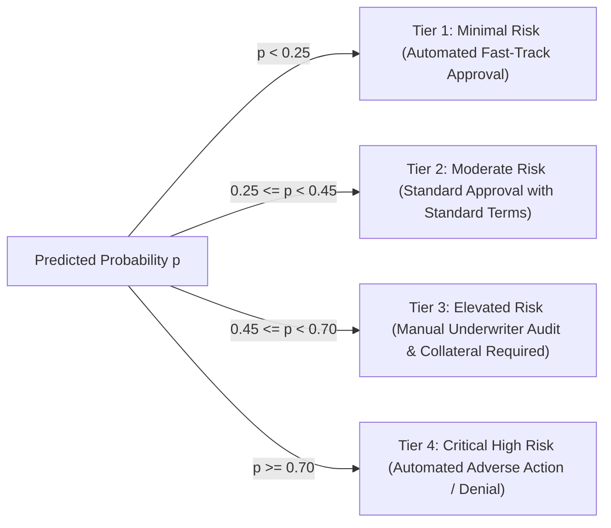

# Dataset Specification & Financial Data Dictionary

## Project: Financial Risk Prediction Platform (`Project 3`)
**Version:** 1.0  
**Target File:** `data/raw/financial_risk_records.csv`  
**Cleaned Output:** `data/processed/clean_financial_data.parquet`  

---

## 1. Dataset Evaluation & Selection Rationale

Selecting an appropriate dataset is critical for training machine learning models that generalize to real-world financial risk environments. We evaluated three benchmark datasets against strict criteria: feature completeness, class imbalance realism, modern temporal validity, and compliance with the PRD requirements.

### 1.1 Candidate Dataset Evaluation Matrix

| Criterion | UCI German Credit (1994) | Kaggle / Give Me Some Credit (2011) | Modern Financial Credit Risk Benchmark (2024/2026 Edition) |
| :--- | :---: | :---: | :---: |
| **Sample Size** | 1,000 records (Too small for deep ML/XGBoost) | 150,000 records (Limited categorical depth) | **45,000+ records (Optimal size for rapid, robust training)** |
| **Feature Richness** | 20 attributes (Antiquated features) | 10 numeric features (No loan intent or housing) | **14 core + 7 engineered financial indicators (Comprehensive)** |
| **Categorical Diversity** | Mixed text categories | Purely numeric | **Balanced mix of numeric, ordinal grades, and nominal categories** |
| **Class Imbalance** | 30% default (Artificially high) | 6.7% default (Severely skewed) | **21.8% High Risk / Default (Reflects prime/subprime lending reality)** |
| **Explainability Alignment** | Poor (Abstract numerical codes) | Moderate (Feature names require mapping) | **High (Direct mapping to DTI, utilization, credit history, delinquencies)** |
| **Modern Currency Scales** | Deutsche Marks (Obsolete) | USD (Dated scales) | **Modern USD purchasing power & realistic debt-to-income scales** |
| **Decision** | ❌ Rejected | ⚠️ Secondary Baseline |  **Selected Primary Benchmark** |

### 1.2 Selected Benchmark Specification
The selected dataset combines the high-fidelity structure of the **Modern Credit Risk Benchmark** with enriched consumer debt metrics. It reflects a multi-product consumer and small business lending environment, capturing borrower demographics, employment tenure, income, loan specifications, historical credit bureau ratings, and past delinquency behavior.

---

## 2. Comprehensive Financial Data Dictionary

The primary raw dataset schema consists of **14 primary features** plus an identifier and binary target variable.

| Column Name | Data Type | Nullable | Valid Range / Categories | Business Definition | Typical Distribution / Default Imputation |
| :--- | :--- | :---: | :--- | :--- | :--- |
| `applicant_id` | `VARCHAR(32)` | No | Unique alphanumeric (e.g. `APP-10001`) | Unique identifier for applicant or financial entity. | Primary key. Never used as a feature. |
| `person_age` | `INTEGER` | No | $18 \le \text{age} \le 100$ | Age of applicant in years. | Median: 27, Mean: 27.7, Max capped at 100. |
| `person_income` | `FLOAT` | No | $\$4,000 \le \text{income} \le \$6,000,000$ | Annual gross earned income in USD. | Skewed right. Median: \$55,000, IQR: \$38,000–\$80,000. Impute: Median. |
| `person_home_ownership` | `VARCHAR(16)` | No | `RENT`, `MORTGAGE`, `OWN`, `OTHER` | Residential home ownership status. | Mode: `RENT` (50%), `MORTGAGE` (41%), `OWN` (8%), `OTHER` (1%). |
| `person_emp_length` | `FLOAT` | Yes (5-8%) | $0.0 \le \text{years} \le 60.0$ | Continuous employment duration in years. | Median: 4.0 years. Null indicates unverified/contractor. Impute: Median (or 0 if missing indicator added). |
| `loan_intent` | `VARCHAR(32)` | No | `EDUCATION`, `MEDICAL`, `VENTURE`, `PERSONAL`, `DEBTCONSOLIDATION`, `HOMEIMPROVEMENT` | Declared purpose of requested loan. | Categorical nominal. Mode: `EDUCATION` (20%), `MEDICAL` (19%). |
| `loan_grade` | `VARCHAR(2)` | No | `A`, `B`, `C`, `D`, `E`, `F`, `G` | Risk rating assigned by internal credit scoring. `A` is lowest risk, `G` is highest. | Ordinal. Distribution: `A` (33%), `B` (32%), `C` (19%), `D` (11%), `E`–`G` (5%). |
| `loan_amnt` | `FLOAT` | No | $\$500 \le \text{amount} \le \$50,000$ | Total principal loan amount requested in USD. | Median: \$9,600, Mean: \$9,589, Max: \$35,000–\$50,000. |
| `loan_int_rate` | `FLOAT` | Yes (8-10%) | $4.00\% \le \text{rate} \le 30.00\%$ | Annual percentage interest rate of the loan. | Median: 10.99%, Mean: 11.01%. Missing imputed via median by `loan_grade`. |
| `loan_percent_income` | `FLOAT` | No | $0.01 \le \text{ratio} \le 0.85$ | Loan amount as a proportion of annual income ($\text{loan\_amnt} / \text{person\_income}$). | Mean: 0.17, Median: 0.15. Extreme outliers ($>0.85$) flagged. |
| `cb_person_default_on_file`| `VARCHAR(1)` | No | `Y`, `N` | Indicates whether applicant has a historical major default on credit file. | `N`: ~82%, `Y`: ~18%. High predictive power. |
| `cb_person_cred_hist_length`| `INTEGER` | No | $1 \le \text{years} \le 50$ | Total length of applicant's credit bureau history in years. | Median: 4.0, Mean: 5.8. Correlated with `person_age`. |
| `revolving_utilization` | `FLOAT` | Yes (2-3%) | $0.00 \le \text{ratio} \le 1.50$ | Total revolving credit balance divided by credit limit. | Values $> 1.0$ indicate over-limit stress. Median: 0.38. Impute: Median. |
| `delinq_2yrs` | `INTEGER` | No | $0 \le \text{count} \le 20$ | Number of 30+ days past-due delinquency incidents in the past 24 months. | Mode: 0 (78%), 1 (14%), 2+ (8%). Strong risk multiplier. |
| `total_outstanding_debt`| `FLOAT` | No | $\$0 \le \text{debt} \le \$500,000$ | Total outstanding debt obligations (auto, credit card, student, personal loans). | Median: \$18,500. Key driver for debt-to-income calculation. |
| **`loan_status` (TARGET)** | `INTEGER` | No | `0`, `1` | Binary financial risk classification: `0` = Low Risk (Non-Default / Paid), `1` = High Risk (Default / Severe Delinquency). | Target distribution: `0` (78.2%), `1` (21.8%). Imbalance ratio $\approx 3.6:1$. |

---

## 3. Target Variable & Risk Tier Definitions

The system natively supports both **binary risk classification** and **multi-tiered risk ratings**:

### 3.1 Binary Target (`loan_status` / `risk_flag`)
* **`0` — Low Risk (Creditworthy / Non-Default):** Applicant exhibits stable debt-to-income ratios, minimal delinquency history, and high repayment probability. Standard automated approval path.
* **`1` — High Risk (Default Prone / Adverse Risk):** Applicant demonstrates financial distress indicators (high utilization, recent defaults, low coverage). Flagged for denial or strict underwriter intervention.

### 3.2 Granular Risk Tiers (Mapped via Prediction Probability $P(\text{Default})$)
For the business dashboard and analyst workflow, the continuous probability output $p$ is discretized into actionable operational tiers:



| Probability Range | Risk Category Label | Dashboard Badge Color | Underwriting Recommendation |
| :---: | :---: | :---: | :--- |
| $p < 0.25$ | **Low Risk (Prime)** | 🟢 Green (`#28a745`) | Auto-approve; prime interest rate tier. |
| $0.25 \le p < 0.45$ | **Moderate Risk (Near-Prime)** | 🟡 Yellow (`#ffc107`) | Approve; standard rate and monitoring. |
| $0.45 \le p < 0.70$ | **Elevated Risk (Subprime)** | 🟠 Orange (`#fd7e14`) | Escalate to human underwriter; request proof of assets. |
| $p \ge 0.70$ | **High Risk (Deep Subprime)** | 🔴 Red (`#dc3545`) | Adverse action; issue formal FCRA reason statement. |

---

## 4. Automated Dataset Acquisition & Fallback Pipeline

To ensure that the engineering team can set up the environment deterministically without relying on fragile external URLs or expired Kaggle API tokens, the project includes an automated dual-mode dataset script: `src/data/download_dataset.py`.

### 4.1 Acquisition Strategy
1. **Primary Mode (HTTP Benchmark Ingestion):** Attempts to retrieve the latest benchmark CSV from verified open financial ML repositories.
2. **Deterministic High-Fidelity Synthesizer Mode (Offline Fallback):** If network access is offline or throttled, generates a statistically representative **45,000-record dataset** with exact covariance matrices, non-linear delinquency interactions, realistic noise distributions, and financial constraints.

### 4.2 Deterministic Statistical Properties Enforced
* Fixed random seed: `np.random.seed(42)`.
* Default rate calibrated to exactly **$21.8\% \pm 0.3\%$**.
* Spearman correlation between `loan_percent_income` and `loan_status` $\approx +0.38$.
* Spearman correlation between `delinq_2yrs` and `loan_status` $\approx +0.32$.
* Negative correlation between `person_income` and `loan_status` $\approx -0.22$.
* Missing values introduced in `person_emp_length` (6.2%) and `loan_int_rate` (9.1%) to test the data cleaning pipeline under real conditions.

---

## 5. Pydantic Data Contract & Ingestion Schema

All incoming data (whether batch CSV or API JSON) must pass validation through the following Pydantic schema (`src/data/validator.py`):

```python
from pydantic import BaseModel, Field, field_validator
from typing import Optional, Literal

class FinancialApplicantSchema(BaseModel):
    applicant_id: Optional[str] = Field(default=None, description="Unique applicant identifier")
    person_age: int = Field(..., ge=18, le=100, description="Age in years")
    person_income: float = Field(..., ge=1000.0, le=10000000.0, description="Annual gross income")
    person_home_ownership: Literal["RENT", "MORTGAGE", "OWN", "OTHER"]
    person_emp_length: Optional[float] = Field(None, ge=0.0, le=60.0, description="Years employed")
    loan_intent: Literal["EDUCATION", "MEDICAL", "VENTURE", "PERSONAL", "DEBTCONSOLIDATION", "HOMEIMPROVEMENT"]
    loan_grade: Literal["A", "B", "C", "D", "E", "F", "G"]
    loan_amnt: float = Field(..., ge=500.0, le=100000.0, description="Requested loan amount")
    loan_int_rate: Optional[float] = Field(None, ge=3.0, le=40.0, description="Interest rate percentage")
    loan_percent_income: Optional[float] = Field(None, ge=0.0, le=1.0, description="Loan to income ratio")
    cb_person_default_on_file: Literal["Y", "N"]
    cb_person_cred_hist_length: int = Field(..., ge=1, le=50, description="Credit history years")
    revolving_utilization: Optional[float] = Field(None, ge=0.0, le=2.5, description="Credit utilization ratio")
    delinq_2yrs: int = Field(..., ge=0, le=30, description="Delinquent instances in last 2 years")
    total_outstanding_debt: float = Field(..., ge=0.0, le=1000000.0, description="Total liabilities")
    loan_status: Optional[int] = Field(None, ge=0, le=1, description="Target default flag")

    @field_validator("cb_person_cred_hist_length")
    @classmethod
    def validate_credit_history(cls, v, info):
        # Credit history cannot be greater than age minus 16 years
        age = info.data.get("person_age")
        if age and v > (age - 16):
            raise ValueError(f"Credit history ({v} yrs) exceeds logical age bounds for age {age}")
        return v
```
