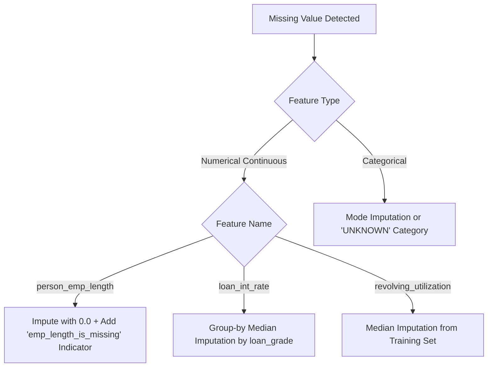

# Data Pipeline & Preprocessing Engineering Specification

## Project: Financial Risk Prediction Platform (`Project 3`)
**Version:** 1.0  
**Module Target:** `src/data/` (`validator.py`, `cleaner.py`, `splitter.py`)  
**Pipeline Orchestration:** `run_pipeline.py`  

---

## 1. Pipeline Architecture & Data Flow

The data preprocessing stage converts dirty, unvalidated financial CSV records into clean, validated, and leak-free training and testing matrices. 

```mermaid
flowchart TD
    A[Raw CSV File Upload] --> B[Schema Validation & Type Enforcement]
    B -->|Schema Invalid| ERR[HTTP 422 / Pipeline Exception Logged]
    B -->|Schema Valid| C[Deduplication on Applicant Key / Features]
    C --> D[Domain Rule Inconsistency Filtering]
    D --> E[Stratified Train-Test Split 80/20]
    E --> F[Training Partition (80%)]
    E --> G[Test Partition (20% Holdout)]
    F --> H[Fit Imputers & Outlier Caps on Train]
    H --> I[Transform Train Split]
    H -->|Apply Fitted Parameters| J[Transform Test Split]
    I --> K[data/processed/train.parquet]
    J --> L[data/processed/test.parquet]
```

> [!IMPORTANT]
> **Strict Anti-Leakage Protocol:** Imputers and scalers must **never** be fitted on the entire dataset. They must be fitted **exclusively on the training partition** and then applied (`.transform()`) to the test partition and production inference streams.

---

## 2. Ingestion & Schema Validation Rules

### 2.1 File Ingestion Constraints
* **Format:** Comma-Separated Values (`.csv`) or Parquet (`.parquet`).
* **Encoding:** `UTF-8` or `ASCII` with fallback handling for `latin1`.
* **Max Payload Size:** 100 MB for interactive dashboard upload; up to 1 GB via batch API.
* **Header Verification:** Headers must match the canonical schema names case-insensitively. Spaces are converted to underscores, and leading/trailing whitespace is stripped.

### 2.2 Required Column Verification
If any of the mandatory columns are absent, the ingestion engine immediately halts and issues an actionable error detailing the missing fields:

```python
MANDATORY_COLUMNS = [
    "person_age", "person_income", "person_home_ownership",
    "loan_intent", "loan_grade", "loan_amnt",
    "cb_person_default_on_file", "cb_person_cred_hist_length",
    "delinq_2yrs", "total_outstanding_debt"
]

OPTIONAL_BUT_ENRICHED_COLUMNS = [
    "applicant_id", "person_emp_length", "loan_int_rate",
    "loan_percent_income", "revolving_utilization", "loan_status"
]
```

---

## 3. Cleansing & Anomaly Resolution Logic

### 3.1 Deduplication
1. Check for duplicate `applicant_id` values. If duplicates exist, retain the latest record (based on timestamp if available) or the record with the fewest missing fields.
2. Check for duplicate rows across all feature columns (identical borrower attributes). Drop duplicate instances to avoid artificial model overfitting.

### 3.2 Inconsistency & Logical Anomaly Filtering
Real-world financial data contains administrative typos and logical contradictions. The cleaner applies domain rules:

| Anomaly Type | Condition | Cleansing Action | Business Rationale |
| :--- | :--- | :--- | :--- |
| **Negative Income** | `person_income < 0` | Absolute value or drop if $< \$1,000$ | Negative gross income is a ledger entry error. |
| **Impossible Age** | `person_age < 18` or `person_age > 105` | Drop record if age $< 18$; cap at 100 if $> 100$ | Minors are legally ineligible for commercial credit. |
| **Anomalous Employment Tenure** | `person_emp_length > (person_age - 14)` | Set `person_emp_length = person_age - 18` | Employment tenure cannot exceed total adult lifespan. |
| **Excessive Credit History** | `cb_person_cred_hist_length > person_age - 14` | Cap at `person_age - 18` | Credit file cannot open before authorized borrowing age. |
| **Extreme Interest Rate** | `loan_int_rate > 40.0` or `loan_int_rate < 2.0` | Winsorize to $[3.0\%, 36.0\%]$ | Usury laws cap consumer rates; extreme values are data entry errors. |
| **Over-limit Utilization** | `revolving_utilization > 3.0` | Cap at 2.50 | Extreme utilization occurs with delinquent fee accrual, capped to prevent scale distortion. |

---

## 4. Missing Value Imputation Strategy

Missing data mechanisms in credit scoring are rarely Missing Completely at Random (MCAR); they are often Missing at Random (MAR) or informative (e.g., individuals without employment history may be contractors or gig workers).



### 4.1 Detailed Imputation Procedures

1. **`person_emp_length` (Missing Rate: 5–8%):**
   * *Strategy:* Impute with `0.0` (conservative credit underwriting assumption) and generate a binary flag feature: `emp_length_missing_flag = 1`.
2. **`loan_int_rate` (Missing Rate: 8–10%):**
   * *Strategy:* Loan interest rate is heavily correlated with credit risk grade (`loan_grade`). Compute the median interest rate **grouped by `loan_grade`** on the training set:
     $$\hat{r}_{\text{int}} = \text{Median}(\text{loan\_int\_rate} \mid \text{loan\_grade} = g)$$
   * If `loan_grade` is also missing, fall back to global training median ($\approx 10.99\%$).
3. **`revolving_utilization` (Missing Rate: 2–3%):**
   * *Strategy:* Impute with global median utilization from the training set ($\approx 0.38$).
4. **`loan_percent_income` (If missing in upload):**
   * *Strategy:* Recompute dynamically: $\text{loan\_amnt} / \text{person\_income}$.

---

## 5. Outlier Auditing & Winsorization Protocols

Outliers in financial datasets frequently carry valid risk signals (e.g., an individual earning \$2,000,000 or carrying \$400,000 in debt). Hard truncation discards vital predictive variance. We therefore employ a **two-tier outlier protocol**:

### 5.1 Tier 1: Domain-Specific Guardrails (Hard Bounds)
* `person_income`: Minimum \$4,000. Maximum \$2,500,000 (values exceeding this are Winsorized to \$2,500,000).
* `loan_amnt`: Maximum capped at \$50,000.
* `delinq_2yrs`: Maximum capped at 10.

### 5.2 Tier 2: Statistical Winsorization for Linear Models
For distance-based and linear models (Logistic Regression, SVM), features with extreme kurtosis are capped at the 1st and 99th percentiles calculated **strictly on the training split**:
$$X_{\text{winsorized}} = \min(\max(X, Q_{0.01}), Q_{0.99})$$

Tree-based models (Random Forest, XGBoost) natively handle monotonic outliers and utilize raw scaled values.

---

## 6. Train-Test Splitting & Partitioning Protocol

### 6.1 Stratified Splitting
Because the target variable (`loan_status`) has a class imbalance ($\approx 21.8\%$ default rate), a simple random split introduces variance in class distribution across partitions.

* **Split Ratio:** 80% Training ($N \approx 36,000$), 20% Held-Out Testing ($N \approx 9,000$).
* **Stratification Column:** `loan_status` (enforces identical $21.8\%$ default rate in both partitions).
* **Random Seed:** Deterministically fixed to `42`.
* **Shuffle:** `True`.

### 6.2 Data Partition Storage
Outputs are serialized using **Apache Parquet with Snappy compression** to guarantee data type fidelity and fast I/O:
* `data/processed/train.parquet`
* `data/processed/test.parquet`
* `data/processed/preprocessing_metadata.json` (Stores fitted medians, category vocabularies, and outlier percentiles).

---

## 7. Python Implementation Specification

The data cleaner must be implemented as a clean, reusable class in `src/data/cleaner.py`:

```python
import pandas as pd
import numpy as np
from typing import Tuple, Dict, Any

class FinancialDataCleaner:
    def __init__(self):
        self.fitted_medians_: Dict[str, float] = {}
        self.grade_int_rates_: Dict[str, float] = {}
        self.is_fitted: bool = False

    def fit(self, df: pd.DataFrame) -> "FinancialDataCleaner":
        """Learn imputation values strictly from training set."""
        self.fitted_medians_["person_emp_length"] = float(df["person_emp_length"].median())
        self.fitted_medians_["revolving_utilization"] = float(df["revolving_utilization"].median())
        self.fitted_medians_["loan_int_rate"] = float(df["loan_int_rate"].median())
        
        # Learn median interest rate by loan grade
        if "loan_grade" in df.columns and "loan_int_rate" in df.columns:
            self.grade_int_rates_ = df.groupby("loan_grade")["loan_int_rate"].median().to_dict()
            
        self.is_fitted = True
        return self

    def transform(self, df: pd.DataFrame) -> pd.DataFrame:
        """Apply learned imputations and clean rules."""
        if not self.is_fitted:
            raise RuntimeError("FinancialDataCleaner must be fitted before calling transform().")
            
        cleaned = df.copy()
        
        # 1. Deduplicate
        cleaned = cleaned.drop_duplicates(subset=[c for c in cleaned.columns if c != "applicant_id"])
        
        # 2. Domain boundary checks
        cleaned.loc[cleaned["person_age"] > 100, "person_age"] = 100
        cleaned.loc[cleaned["person_age"] < 18, "person_age"] = 18
        
        # 3. Impute employment length
        cleaned["emp_length_missing_flag"] = cleaned["person_emp_length"].isna().astype(int)
        cleaned["person_emp_length"] = cleaned["person_emp_length"].fillna(0.0)
        
        # 4. Impute interest rate by grade
        for grade, med_rate in self.grade_int_rates_.items():
            mask = (cleaned["loan_grade"] == grade) & (cleaned["loan_int_rate"].isna())
            cleaned.loc[mask, "loan_int_rate"] = med_rate
        cleaned["loan_int_rate"] = cleaned["loan_int_rate"].fillna(self.fitted_medians_["loan_int_rate"])
        
        # 5. Impute utilization
        cleaned["revolving_utilization"] = cleaned["revolving_utilization"].fillna(
            self.fitted_medians_["revolving_utilization"]
        )
        
        # 6. Recompute loan percent income if missing
        if "loan_percent_income" not in cleaned.columns or cleaned["loan_percent_income"].isna().any():
            cleaned["loan_percent_income"] = (cleaned["loan_amnt"] / cleaned["person_income"]).round(4)
            
        return cleaned

    def fit_transform(self, df: pd.DataFrame) -> pd.DataFrame:
        return self.fit(df).transform(df)
```
