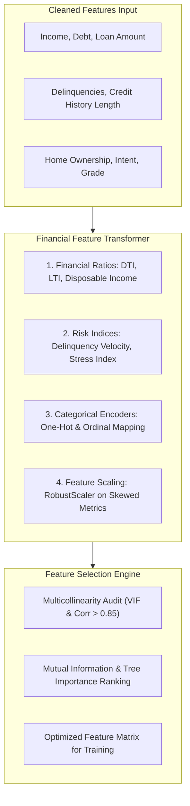

# Feature Engineering & Selection Engineering Specification

## Project: Financial Risk Prediction Platform (`Project 3`)
**Version:** 1.0  
**Module Target:** `src/features/` (`transformers.py`, `selector.py`, `pipeline.py`)  
**Artifact Destination:** `data/features/` and serialized within `models/champion_model.joblib`  

---

## 1. Feature Engineering Philosophy & Architecture

In financial risk modeling, raw features (e.g. gross income or raw debt) lack contextual predictive power when considered in isolation. An annual income of \$60,000 carries completely different risk profiles depending on whether the borrower carries \$5,000 or \$45,000 in outstanding liabilities.

Domain-driven feature engineering constructs **ratio-based, interaction-based, and behavioral stability indicators** that mirror credit underwriting heuristics.



---

## 2. Derived Financial Risk Indicators & Mathematical Formulas

The feature transformer creates **7 high-signal derived financial metrics**:

### 2.1 Debt-to-Income (DTI) Ratio
Measures the proportion of monthly gross income consumed by total outstanding debt obligations:
$$\text{DTI} = \frac{\text{total\_outstanding\_debt} / 12}{(\text{person\_income} / 12) + \epsilon} = \frac{\text{total\_outstanding\_debt}}{\text{person\_income} + \epsilon}$$
* *Interpretation:* Ratios $> 0.43$ (43%) trigger regulatory Qualified Mortgage thresholds and represent acute leverage risk.
* *Parameter:* $\epsilon = 1.0$ (prevents division by zero).

### 2.2 Loan-to-Income (LTI) Ratio
Evaluates the magnitude of the requested new loan relative to annual earning power:
$$\text{LTI} = \frac{\text{loan\_amnt}}{\text{person\_income} + \epsilon}$$
* *Interpretation:* Borrowers requesting $> 30\%$ of annual income in unsecured personal loans carry elevated default probabilities.

### 2.3 Estimated Monthly Disposable Income
Estimates the surplus monthly cash flow available to service the new loan after meeting existing debt obligations:
$$\text{Disposable\_Monthly\_Income} = \left(\frac{\text{person\_income}}{12}\right) - \left(\frac{\text{total\_outstanding\_debt}}{36}\right) - \text{Estimated\_Living\_Expenses}$$
* *Operational Approximation:* 
  $$\text{Disposable\_Income} = \frac{\text{person\_income} - 0.35 \times \text{total\_outstanding\_debt}}{12}$$
* *Interpretation:* Negative or near-zero disposable income indicates extreme vulnerability to liquidity shocks.

### 2.4 Estimated Loan Monthly Payment & Payment-to-Income (PTI)
Approximates the amortized monthly payment using the standard annuity formula:
$$M = P \times \frac{r(1+r)^n}{(1+r)^n - 1}$$
* Where $P = \text{loan\_amnt}$, $r = \frac{\text{loan\_int\_rate}}{100 \times 12}$, and standard term $n = 36 \text{ months}$.
* **Payment-to-Income (PTI):**
  $$\text{PTI} = \frac{M}{\text{person\_income} / 12}$$

### 2.5 Delinquency Severity Index (DSI)
Weights past-due incidents against total credit history length to measure delinquency velocity:
$$\text{DSI} = \frac{\text{delinq\_2yrs} \times 10}{\text{cb\_person\_cred\_hist\_length} + 1}$$
* *Interpretation:* A borrower with 2 delinquencies in 3 years of history is substantially riskier than a borrower with 2 delinquencies over 25 years of history.

### 2.6 Credit History Stability Index
Evaluates employment stability against credit file tenure:
$$\text{Stability\_Index} = \frac{\text{person\_emp\_length} + 1}{\text{cb\_person\_cred\_hist\_length} + 1}$$

### 2.7 Financial Stress Composite Score (FSCS)
A composite index combining credit utilization, DTI, interest rate burden, and historical default:
$$\text{FSCS} = 0.30 \times \text{revolving\_utilization} + 0.30 \times \min(\text{DTI}, 1.0) + 0.25 \times \left(\frac{\text{loan\_int\_rate}}{30.0}\right) + 0.15 \times \mathbb{I}(\text{default\_on\_file} = \text{'Y'})$$
* Normalized continuous range: $[0.0, 1.0]$. A higher score indicates severe financial distress.

---

## 3. Categorical Encoding Strategies

| Feature Name | Cardinality | Recommended Encoding | Justification |
| :--- | :---: | :--- | :--- |
| `loan_grade` | 7 (`A` through `G`) | **Ordinal Integer Mapping** (`A`=1, `B`=2, ..., `G`=7) | Inherent natural ranking; preserves monotonicity for linear models and tree splits. |
| `person_home_ownership` | 4 (`RENT`, `OWN`, `MORTGAGE`, `OTHER`) | **One-Hot Encoding** (`drop='first'`) | Nominal; small cardinality; avoids imposing artificial distance. |
| `loan_intent` | 6 (`EDUCATION`, `MEDICAL`, etc.) | **One-Hot Encoding** (`drop='first'`) | Nominal; distinct spending behavior profiles. |
| `cb_person_default_on_file` | 2 (`Y`, `N`) | **Binary Mapping** (`Y`=1, `N`=0) | Direct binary flag. |

---

## 4. Feature Scaling & Normalization Protocol

Financial features span vastly divergent orders of magnitude (Income in thousands, Interest rate in tens, Utilization in fractions).

### 4.1 Scaler Selection: `RobustScaler` vs `StandardScaler`
* **`RobustScaler` (Selected for Skewed Financial Features):**
  $$z = \frac{x - Q_{0.50}(x)}{\text{IQR}(x)}$$
  * Centered on median and scaled by Interquartile Range ($Q_{0.75} - Q_{0.25}$).
  * Essential for `person_income`, `total_outstanding_debt`, `loan_amnt`, and `disposable_income`, as extreme valid outliers do not compress the scale of the central distribution.
* **`StandardScaler`:**
  * Applied to features with approximately normal distributions or low kurtosis (`person_age`, `cb_person_cred_hist_length`).

---

## 5. Multicollinearity & Feature Selection Pipeline

### 5.1 Correlation Filtering (Bivariate Collinearity)
Features exhibiting Pearson correlation coefficient $|r| \ge 0.85$ are flagged. Between collinear pairs (e.g. `loan_percent_income` and `loan_amnt` / `person_income`), the feature with the highest Mutual Information score with `loan_status` is retained.

### 5.2 Variance Inflation Factor (VIF) Filter
For linear models (Logistic Regression), VIF is computed iteratively:
$$\text{VIF}_j = \frac{1}{1 - R_j^2}$$
* Features with $\text{VIF} > 10.0$ are iteratively dropped or combined into composite indices.

### 5.3 Algorithmic Feature Importance (Random Forest & Mutual Information)
1. **Mutual Information Classification (`mutual_info_classif`):** Captures both linear and non-linear dependencies with zero parametric assumptions.
2. **Mean Decrease in Impurity (MDI):** Extracted from a shallow Random Forest baseline to rank feature contributions.

---

## 6. Complete Scikit-Learn Pipeline Implementation

The transformer must be implemented as a Scikit-Learn compliant `BaseEstimator` and `TransformerMixin` in `src/features/transformers.py`:

```python
import numpy as np
import pandas as pd
from sklearn.base import BaseEstimator, TransformerMixin
from sklearn.compose import ColumnTransformer
from sklearn.preprocessing import OneHotEncoder, RobustScaler, StandardScaler
from sklearn.pipeline import Pipeline

class FinancialFeatureEngineer(BaseEstimator, TransformerMixin):
    """Generates financial domain features from raw inputs."""
    
    def __init__(self, epsilon: float = 1.0):
        self.epsilon = epsilon

    def fit(self, X: pd.DataFrame, y=None):
        return self

    def transform(self, X: pd.DataFrame) -> pd.DataFrame:
        df = X.copy()
        eps = self.epsilon
        
        # 1. Ratios
        df["debt_to_income"] = (df["total_outstanding_debt"] / (df["person_income"] + eps)).clip(0.0, 5.0)
        df["loan_to_income"] = (df["loan_amnt"] / (df["person_income"] + eps)).clip(0.0, 2.0)
        
        # 2. Disposable Monthly Income
        df["disposable_income"] = (
            (df["person_income"] - 0.35 * df["total_outstanding_debt"]) / 12.0
        ).clip(lower=-5000.0)
        
        # 3. Delinquency Severity Index
        df["delinq_severity_index"] = (
            df["delinq_2yrs"] * 10.0 / (df["cb_person_cred_hist_length"] + 1.0)
        ).clip(0.0, 50.0)
        
        # 4. Employment Stability
        df["stability_index"] = (
            (df["person_emp_length"] + 1.0) / (df["cb_person_cred_hist_length"] + 1.0)
        ).clip(0.0, 10.0)
        
        # 5. Ordinal Grade Mapping
        grade_map = {"A": 1, "B": 2, "C": 3, "D": 4, "E": 5, "F": 6, "G": 7}
        df["loan_grade_numeric"] = df["loan_grade"].map(grade_map).fillna(4).astype(int)
        
        # 6. Binary Default on file mapping
        df["default_on_file_binary"] = (df["cb_person_default_on_file"] == "Y").astype(int)
        
        # 7. Financial Stress Composite Score
        util = df["revolving_utilization"].clip(0.0, 1.5)
        dti_norm = df["debt_to_income"].clip(0.0, 1.0)
        rate_norm = (df["loan_int_rate"] / 30.0).clip(0.0, 1.0)
        df["financial_stress_score"] = (
            0.30 * util + 0.30 * dti_norm + 0.25 * rate_norm + 0.15 * df["default_on_file_binary"]
        )
        
        return df


def build_preprocessor_pipeline() -> Pipeline:
    """Constructs the unified preprocessing and feature engineering Pipeline."""
    
    numeric_robust_features = [
        "person_income", "loan_amnt", "total_outstanding_debt",
        "debt_to_income", "loan_to_income", "disposable_income"
    ]
    
    numeric_standard_features = [
        "person_age", "person_emp_length", "loan_int_rate",
        "cb_person_cred_hist_length", "revolving_utilization",
        "delinq_2yrs", "delinq_severity_index", "stability_index",
        "loan_grade_numeric", "default_on_file_binary", "financial_stress_score"
    ]
    
    categorical_features = ["person_home_ownership", "loan_intent"]
    
    column_transform = ColumnTransformer(
        transformers=[
            ("robust", RobustScaler(), numeric_robust_features),
            ("standard", StandardScaler(), numeric_standard_features),
            ("onehot", OneHotEncoder(drop="first", handle_unknown="ignore", sparse_output=False), categorical_features)
        ],
        remainder="drop"
    )
    
    full_pipeline = Pipeline(steps=[
        ("engineer", FinancialFeatureEngineer()),
        ("preprocess", column_transform)
    ])
    
    return full_pipeline
```
