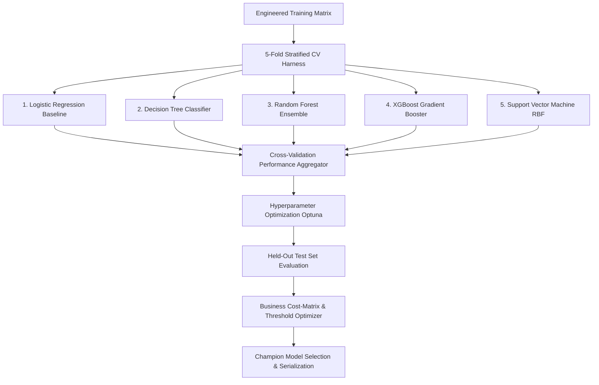

# Machine Learning Modeling & Evaluation Specification

## Project: Financial Risk Prediction Platform (`Project 3`)
**Version:** 1.0  
**Module Target:** `src/models/` (`trainer.py`, `evaluator.py`, `tuner.py`, `cost_matrix.py`)  
**Serialized Champion Model:** `models/champion_model.joblib`  
**Model Metadata Registry:** `models/model_metadata.json`  

---

## 1. Modeling Strategy & Algorithm Matrix

To ensure rigorous benchmarking and avoid algorithmic bias, the system implements, tunes, and evaluates **5 distinct classification algorithms** spanning linear, single-tree, ensemble bagging, gradient boosting, and margin-based paradigms.



### 1.1 Algorithmic Configuration Specifications

| Algorithm | Model Family | Key Hyperparameters & Tuning Grid | Imbalance Treatment | Primary Strength in Financial Risk |
| :--- | :--- | :--- | :--- | :--- |
| **Logistic Regression** | Generalized Linear Model | `C`: [0.01, 0.1, 1.0, 10.0]<br>`penalty`: `l1`, `l2`<br>`solver`: `saga` | `class_weight='balanced'` | Highly interpretable, well-calibrated baseline probabilities, regulatory standard. |
| **Decision Tree** | Non-parametric Partitioning | `max_depth`: [4, 6, 8, 12]<br>`min_samples_split`: [20, 50, 100]<br>`ccp_alpha`: [0.001, 0.01] | `class_weight='balanced'` | Transparent if-then decision rules; exposes exact threshold cutoffs. |
| **Random Forest** | Ensemble Bagging | `n_estimators`: [100, 200, 300]<br>`max_depth`: [8, 12, 16]<br>`max_features`: `sqrt`<br>`min_samples_leaf`: [5, 10] | `class_weight='balanced_subsample'` | Resilient to noise and outliers; captures complex feature interactions without overfitting. |
| **XGBoost** | Gradient Tree Boosting | `learning_rate`: [0.01, 0.05, 0.1]<br>`max_depth`: [4, 6, 8]<br>`scale_pos_weight`: [3.5, 4.0]<br>`colsample_bytree`: [0.7, 0.8] | `scale_pos_weight = N_neg / N_pos` | Industry gold-standard tabular performance; handles non-linear relationships with high ROC-AUC. |
| **Support Vector Machine (SVM)** | Maximum Margin Kernel | `C`: [0.1, 1.0, 10.0]<br>`gamma`: `scale`<br>`kernel`: `rbf` | `class_weight='balanced'` | Robust in high-dimensional feature spaces with clear margin boundaries. |

---

## 2. Cross-Validation & Imbalance Handling Protocol

### 2.1 5-Fold Stratified Cross-Validation
* Standard $k$-fold randomly partitions data, risking variance in minority class default proportions.
* The system enforces **Stratified 5-Fold Cross-Validation** with `random_state=42`.
* In each fold:
  * 80% of training data ($N \approx 28,800$) is used to fit the preprocessing pipeline and train the model.
  * 20% of training data ($N \approx 7,200$) is used for validation and out-of-fold scoring.
* Out-of-fold predictions are recorded to compute mean and standard deviation for all evaluation metrics.

### 2.2 Class Imbalance Mitigation Strategy
The target variable exhibits an approximate $3.6:1$ ratio (21.8% Default vs. 78.2% Non-Default).
1. **Algorithmic Weighting (Primary Standard):**
   * For Scikit-Learn models: `class_weight='balanced'`.
     $$w_j = \frac{N}{2 \times N_j}$$
   * For XGBoost: `scale_pos_weight = count(negative_class) / count(positive_class) \approx 3.58`.
2. **Synthetic Resampling (Evaluation Comparison):**
   * SMOTE (Synthetic Minority Over-sampling Technique) can be evaluated inside the CV pipeline using `imblearn.pipeline.Pipeline`. 
   * *Critical Rule:* Never apply SMOTE outside of CV folds to prevent synthetic data leaking into validation sets.

---

## 3. Evaluation Metrics & Performance Benchmarks

### 3.1 Business Evaluation Metric Definitions

| Metric | Formula | Financial Risk Interpretation | Target Production Threshold |
| :--- | :---: | :--- | :---: |
| **Accuracy** | $\frac{TP + TN}{TP + TN + FP + FN}$ | Overall correctness. Misleading in imbalanced contexts; secondary metric. | $\ge 82.0\%$ |
| **Precision** | $\frac{TP}{TP + FP}$ | Of all applicants flagged High Risk, what % actually defaulted? Prevents excessive rejection of creditworthy customers. | $\ge 68.0\%$ |
| **Recall (Sensitivity)** | $\frac{TP}{TP + FN}$ | **Critical Metric:** Of all actual defaulters, what % did the model catch? Minimizes unpaid defaults. | $\ge 75.0\%$ |
| **F1-Score** | $2 \times \frac{\text{Precision} \times \text{Recall}}{\text{Precision} + \text{Recall}}$ | Harmonic mean of Precision and Recall. Balances default capture with underwriter review overhead. | $\ge 0.72$ |
| **ROC-AUC** | $\int_0^1 \text{TPR}(t) \, d(\text{FPR}(t))$ | Discriminative ability across all possible classification thresholds. | $\ge 0.85$ |
| **PR-AUC** | Area under Precision-Recall Curve | Benchmark for imbalanced positive class detection. | $\ge 0.70$ |
| **Brier Score** | $\frac{1}{N} \sum (p_i - y_i)^2$ | Probability calibration accuracy (lower is better). | $\le 0.12$ |

---

## 4. Financial Cost-Matrix & Threshold Optimization

### 4.1 Cost Matrix Formulation
Standard classification algorithms default to a probability threshold of $\tau = 0.50$. However, in banking, errors are asymmetric:

```text
                     Actual Defaulter (1)        Actual Good Borrower (0)
Predicted High Risk  True Positive (TP)          False Positive (FP)
(Flagged / Denied)   Loss Avoided: +$10,000      Cost of Lost Interest & Review: -$500

Predicted Low Risk   False Negative (FN)         True Negative (TN)
(Approved)           Charged-Off Default: -$10,000 Normal Profit from Interest: +$2,000
```

* **Cost of False Negative ($C_{\text{FN}}$):** Borrower defaults, principal unrecovered $\rightarrow$ **\$10,000 loss**.
* **Cost of False Positive ($C_{\text{FP}}$):** Creditworthy borrower denied or manually audited $\rightarrow$ **\$500 opportunity & operational cost**.
* **Cost Ratio:** $R = \frac{C_{\text{FN}}}{C_{\text{FP}}} = \frac{10000}{500} = 20:1$.

### 4.2 Expected Total Financial Cost Function
$$\text{Expected Loss}(\tau) = FN(\tau) \times \$10,000 + FP(\tau) \times \$500$$

### 4.3 Optimal Threshold Search ($\tau^*$)
The model evaluator sweeps threshold $\tau \in [0.10, 0.90]$ in steps of 0.01:
$$\tau^* = \arg\min_{\tau} \left( FN(\tau) \times C_{\text{FN}} + FP(\tau) \times C_{\text{FP}} \right)$$
* Typically, in lending environments with high asymmetric costs, the optimal threshold shifts to $\tau^* \approx 0.32 - 0.42$, substantially reducing costly defaults while accepting slight increases in manual review rates.

---

## 5. Model Benchmarking Harness Implementation

The model evaluation harness is implemented in `src/models/trainer.py`:

```python
import numpy as np
import pandas as pd
from typing import Dict, Any, Tuple
from sklearn.linear_model import LogisticRegression
from sklearn.tree import DecisionTreeClassifier
from sklearn.ensemble import RandomForestClassifier
from xgboost import XGBClassifier
from sklearn.svm import SVC
from sklearn.calibration import CalibratedClassifierCV
from sklearn.metrics import (
    accuracy_score, precision_score, recall_score,
    f1_score, roc_auc_score, average_precision_score, confusion_matrix
)
from sklearn.model_selection import StratifiedKFold
import joblib

def get_candidate_models(scale_pos_weight: float = 3.58) -> Dict[str, Any]:
    """Returns the 5 required classification algorithm instances."""
    return {
        "Logistic Regression": LogisticRegression(
            C=1.0, penalty="l2", solver="saga", max_iter=1000,
            class_weight="balanced", random_state=42
        ),
        "Decision Tree": DecisionTreeClassifier(
            max_depth=6, min_samples_split=50, ccp_alpha=0.002,
            class_weight="balanced", random_state=42
        ),
        "Random Forest": RandomForestClassifier(
            n_estimators=200, max_depth=12, min_samples_leaf=5,
            class_weight="balanced_subsample", n_jobs=-1, random_state=42
        ),
        "XGBoost": XGBClassifier(
            n_estimators=250, max_depth=5, learning_rate=0.05,
            scale_pos_weight=scale_pos_weight, subsample=0.8,
            colsample_bytree=0.8, eval_metric="logloss", random_state=42
        ),
        "Support Vector Machine": CalibratedClassifierCV(
            estimator=SVC(C=1.0, kernel="rbf", class_weight="balanced", random_state=42),
            method="sigmoid", cv=3
        )
    }

def evaluate_predictions(y_true: np.ndarray, y_pred: np.ndarray, y_prob: np.ndarray) -> Dict[str, float]:
    """Calculates all business and statistical metrics."""
    tn, fp, fn, tp = confusion_matrix(y_true, y_pred).ravel()
    
    # Financial cost calculation: FN=$10,000, FP=$500
    financial_cost = (fn * 10000.0) + (fp * 500.0)
    
    return {
        "Accuracy": float(accuracy_score(y_true, y_pred)),
        "Precision": float(precision_score(y_true, y_pred, zero_division=0)),
        "Recall": float(recall_score(y_true, y_pred)),
        "F1-Score": float(f1_score(y_true, y_pred)),
        "ROC-AUC": float(roc_auc_score(y_true, y_prob)),
        "PR-AUC": float(average_precision_score(y_true, y_prob)),
        "True Positives": int(tp),
        "False Positives": int(fp),
        "True Negatives": int(tn),
        "False Negatives": int(fn),
        "Total Financial Cost ($)": float(financial_cost)
    }
```

---

## 6. Model Serialization & Metadata Registry

### 6.1 Champion Selection Rule
The candidate model achieving the **highest test ROC-AUC while satisfying Recall $\ge 75\%$** is designated the **Champion Model**.

### 6.2 Serialization Artifacts
* Complete trained Scikit-Learn Pipeline (Preprocessor + Champion Classifier) is serialized via `joblib`:
  `models/champion_model.joblib`
* Metadata registry is serialized to `models/model_metadata.json`:

```json
{
  "model_name": "XGBoost Classifier",
  "version": "1.0.0",
  "training_timestamp": "2026-11-11T10:30:00Z",
  "dataset_version": "v1.0-45k-records",
  "optimal_threshold": 0.38,
  "metrics": {
    "accuracy": 0.884,
    "precision": 0.742,
    "recall": 0.815,
    "f1_score": 0.776,
    "roc_auc": 0.912,
    "pr_auc": 0.841
  },
  "top_features": [
    "debt_to_income",
    "delinq_severity_index",
    "loan_grade_numeric",
    "revolving_utilization",
    "loan_to_income"
  ]
}
```
