# Machine Learning Pipeline Design & Modeling Specification

- **System:** Financial Risk Prediction Platform (FRP-ML)
- **Document Version:** 1.0.0
- **Status:** Approved / Engineering Specification
- **Target Algorithms:** 5 Distinct Classifiers (Logistic Regression, Decision Tree, Random Forest, XGBoost, SVM)

---

## 1. End-to-End Pipeline Workflow

The ML system is organized into a strict, reproducible pipeline preventing data leakage and ensuring determinism.

```mermaid
flowchart LR
    A["Raw Data (CSV)"] --> B["Data Validation & Cleaning"]
    B --> C["Stratified Train/Test Split (80/20)"]
    C --> D["Custom Feature Engineering"]
    D --> E["ColumnTransformer (Impute + Encode + Scale)"]
    E --> F["5-Fold Stratified CV"]
    F --> G["Model Benchmarking (5 Classifiers)"]
    G --> H["Threshold & Cost Optimization"]
    H --> I["Champion Model Serialization (.joblib)"]
    I --> J["SHAP Explainability Wrapper"]
```



---

## 2. Preprocessing & Feature Engineering Pipeline

### 2.1 Column Categorization

```python
NUMERICAL_FEATURES = [
    "person_age",
    "person_income",
    "person_emp_length",
    "loan_amnt",
    "loan_int_rate",
    "loan_percent_income",
    "cb_person_cred_hist_length",
    # Derived features
    "loan_to_income_ratio",
    "interest_burden_index",
    "cred_hist_age_ratio"
]

CATEGORICAL_NOMINAL = [
    "person_home_ownership",  # RENT, OWN, MORTGAGE, OTHER
    "loan_intent"             # PERSONAL, EDUCATION, MEDICAL, etc.
]

CATEGORICAL_ORDINAL = [
    "loan_grade"              # A < B < C < D < E < F < G
]

BINARY_FEATURES = [
    "cb_person_default_on_file"  # Y / N -> 1 / 0
]

TARGET = "loan_status"         # 0 = Low Risk, 1 = High Risk
```

### 2.2 Scikit-Learn Pipeline Assembly

```python
from sklearn.compose import ColumnTransformer
from sklearn.pipeline import Pipeline
from sklearn.impute import SimpleImputer
from sklearn.preprocessing import StandardScaler, OneHotEncoder, OrdinalEncoder

# Numerical pipeline with median imputation and robust scaling
numerical_pipeline = Pipeline([
    ("imputer", SimpleImputer(strategy="median")),
    ("scaler", StandardScaler())
])

# Nominal categorical pipeline with one-hot encoding
nominal_pipeline = Pipeline([
    ("imputer", SimpleImputer(strategy="constant", fill_value="MISSING")),
    ("onehot", OneHotEncoder(handle_unknown="ignore", sparse_output=False))
])

# Ordinal categorical pipeline
grade_order = [["A", "B", "C", "D", "E", "F", "G"]]
ordinal_pipeline = Pipeline([
    ("imputer", SimpleImputer(strategy="constant", fill_value="D")),
    ("ordinal", OrdinalEncoder(categories=grade_order))
])

# Full preprocessor
preprocessor = ColumnTransformer(
    transformers=[
        ("num", numerical_pipeline, NUMERICAL_FEATURES),
        ("nom", nominal_pipeline, CATEGORICAL_NOMINAL),
        ("ord", ordinal_pipeline, CATEGORICAL_ORDINAL),
    ],
    remainder="passthrough"
)
```

---

## 3. The 5 Classification Algorithms & Hyperparameter Spaces

### Model 1: Logistic Regression (Interpretable Baseline)
- **Role:** Industry regulatory baseline, highly interpretable via odds ratios.
- **Algorithm Class:** `sklearn.linear_model.LogisticRegression`
- **Hyperparameter Grid:**
  - `C`: `[0.01, 0.1, 1.0, 10.0]`
  - `penalty`: `['l2']`
  - `solver`: `['lbfgs']`
  - `class_weight`: `['balanced']`
  - `max_iter`: `[1000]`

### Model 2: Decision Tree Classifier (Single Tree Benchmark)
- **Role:** Non-linear rule benchmark; generates transparent boolean decision paths.
- **Algorithm Class:** `sklearn.tree.DecisionTreeClassifier`
- **Hyperparameter Grid:**
  - `max_depth`: `[4, 6, 8, 10, None]`
  - `min_samples_split`: `[10, 25, 50]`
  - `min_samples_leaf`: `[5, 10, 20]`
  - `criterion`: `['gini', 'entropy']`
  - `class_weight`: `['balanced']`

### Model 3: Random Forest Classifier (Ensemble Bagging)
- **Role:** High-performing bagging ensemble; robust against overfitting.
- **Algorithm Class:** `sklearn.ensemble.RandomForestClassifier`
- **Hyperparameter Grid:**
  - `n_estimators`: `[100, 200, 300]`
  - `max_depth`: `[8, 12, 16, None]`
  - `min_samples_split`: `[5, 10]`
  - `min_samples_leaf`: `[2, 4]`
  - `class_weight`: `['balanced', 'balanced_subsample']`
  - `n_jobs`: `[-1]`

### Model 4: XGBoost Classifier (Gradient Boosted Trees - Expected Champion)
- **Role:** State-of-the-art gradient boosting; handles subtle feature interactions and class imbalance.
- **Algorithm Class:** `xgboost.XGBClassifier`
- **Hyperparameter Grid:**
  - `n_estimators`: `[150, 250, 350]`
  - `learning_rate`: `[0.02, 0.05, 0.1]`
  - `max_depth`: `[4, 6, 8]`
  - `subsample`: `[0.8, 1.0]`
  - `colsample_bytree`: `[0.8, 1.0]`
  - `scale_pos_weight`: `[len(negative_samples) / len(positive_samples)]` (~3.57)
  - `eval_metric`: `['logloss']`

### Model 5: Support Vector Machine (SVM) (Non-linear Margin Classifier)
- **Role:** Effective in transformed high-dimensional feature spaces.
- **Algorithm Class:** `sklearn.svm.SVC`
- **Hyperparameter Grid:**
  - `C`: `[0.1, 1.0, 5.0]`
  - `kernel`: `['rbf']`
  - `gamma`: `['scale', 'auto']`
  - `probability`: `[True]` *(Crucial for risk probability scoring)*
  - `class_weight`: `['balanced']`

---

## 4. Class Imbalance & Cost-Sensitive Optimization

### 4.1 Class Distribution
- **Class 0 (Low Risk / Non-Default):** ~78.2%
- **Class 1 (High Risk / Default):** ~21.8%

### 4.2 Imbalance Management Strategy
1. **Algorithmic Weighting:** Use `class_weight='balanced'` across scikit-learn models and `scale_pos_weight` in XGBoost to penalize misclassifications of minority default cases.
2. **SMOTE Resampling:** Support optional synthetic oversampling (`imblearn.over_sampling.SMOTE(random_state=42)`) applied exclusively to training folds.

### 4.3 Cost-Sensitive Decision Threshold Tuning
In financial lending, errors have asymmetric real-world consequences:
- **False Positive (FP):** Creditworthy borrower rejected. Cost = Opportunity loss of interest earnings ($C_{FP} = 1$).
- **False Negative (FN):** Defaulting borrower approved. Cost = Loss of loan principal ($C_{FN} \approx 5$).

The total expected business loss function:
$$\text{Total Financial Cost} = (1 \times FP) + (5 \times FN)$$

The pipeline scans probability thresholds $\tau \in [0.10, 0.60]$ in steps of $0.02$ to identify the threshold $\tau^*$ that minimizes total business cost, rather than blindly relying on the default $0.50$ threshold.

---

## 5. Model Explainability Architecture (SHAP)

### 5.1 XAI Implementation Framework

```python
import shap

class RiskExplainabilityEngine:
    def __init__(self, model, preprocessor, feature_names):
        self.model = model
        self.preprocessor = preprocessor
        self.feature_names = feature_names
        
        # Initialize appropriate explainer
        if hasattr(model, "tree_"):
            self.explainer = shap.TreeExplainer(model)
        elif "XGB" in type(model).__name__:
            self.explainer = shap.TreeExplainer(model)
        else:
            self.explainer = shap.LinearExplainer(model)
            
    def explain_instance(self, raw_record_df):
        transformed = self.preprocessor.transform(raw_record_df)
        shap_values = self.explainer(transformed)
        return shap_values
```

### 5.2 Global vs Local Output Requirements
1. **Global Importance:**
   - Mean absolute SHAP values: $I_j = \frac{1}{N} \sum_{i=1}^N |\phi_{i,j}|$
   - Beeswarm plot displaying feature magnitude vs positive/negative impact on risk.
2. **Local Instance Attribution:**
   - Waterfall plot showing base rate $E[f(X)]$ transitioning to applicant's final probability $f(x)$.
   - Extract Top 3 positive risk drivers (factors increasing risk) and Top 3 negative risk drivers (factors mitigating risk).

---

## 6. Model Registry & Metadata Architecture

Trained models and their evaluation artifacts are stored in a structured registry:

```
models/
├── saved_models/
│   ├── logistic_regression.joblib
│   ├── decision_tree.joblib
│   ├── random_forest.joblib
│   ├── xgboost.joblib
│   ├── svm.joblib
│   └── champion_pipeline.joblib       # Best overall model + preprocessor
└── metadata/
    ├── model_comparison.json          # Multi-model evaluation leaderboard
    ├── best_model_info.json           # Champion model metadata & threshold
    ├── confusion_matrices.json        # Raw confusion matrix counts for each model
    └── shap_global_summary.json       # Top global risk factors
```

### Metadata JSON Schema (`best_model_info.json`)
```json
{
  "model_name": "XGBoost Classifier",
  "version": "1.0.0",
  "trained_at": "2026-11-11T10:00:00Z",
  "optimal_threshold": 0.28,
  "metrics": {
    "accuracy": 0.934,
    "precision": 0.885,
    "recall": 0.792,
    "f1_score": 0.836,
    "roc_auc": 0.942,
    "pr_auc": 0.887
  },
  "hyperparameters": {
    "n_estimators": 250,
    "learning_rate": 0.05,
    "max_depth": 5,
    "scale_pos_weight": 3.58
  }
}
```
